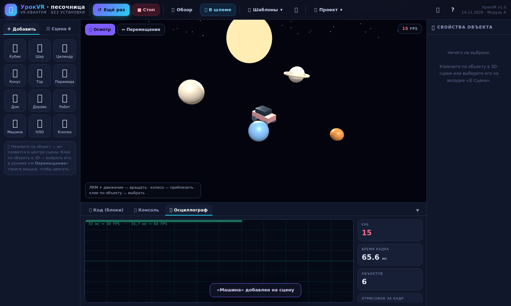
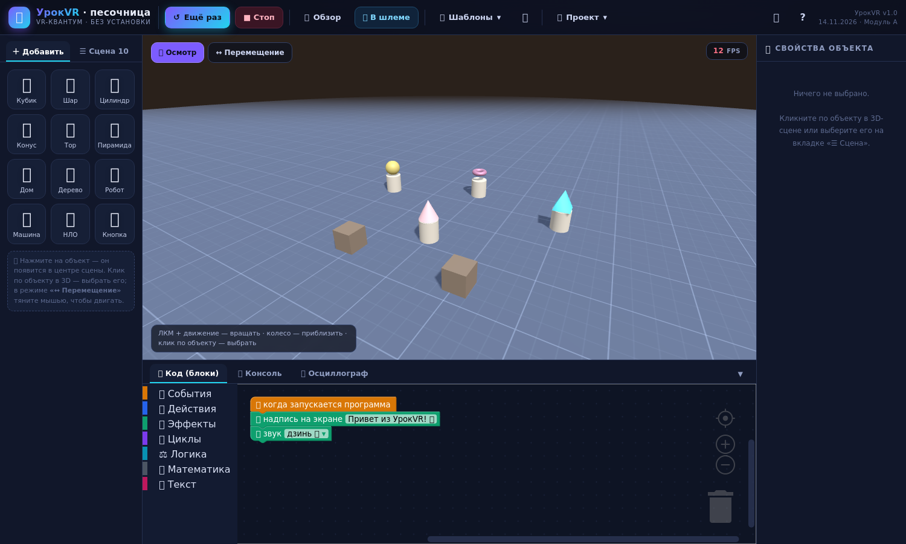

# УрокVR — VR-песочница для VR/AR-квантума

Бесплатная браузерная лаборатория виртуальной реальности для школьного технопарка «Кванториум»:
собрал 3D-сцену → дал объектам поведение на блоках → «надел» шлем (WebXR) или смотришь от первого лица —
**без установки Unity, без шлема на каждого ученика, без интернета**.

Один файл `index.html` (~1,8 МБ) работает офлайн: открой в браузере — и всё.



## Что внутри (Модуль А концепции)

- **3D-редактор сцены** — 12 объектов в библиотеке (кубик → робот, машина, НЛО, кнопка), выделение, перемещение (Shift — шаг 0,5 м), вращение, масштаб, цвет, гравитация с отскоком
- **Блоки вместо кода** (Blockly, русские блоки) — «🏁 когда запускается», «🖱 когда кликнут по…», «⏱ каждые N сек», «подбросить», «перекрасить», «создать объект», «телепорт», звуки. Ступеньки: блоки → JS (далее C# для Unity)
- **Осциллограф кадра** — график времени кадра, draw calls и треугольники («осциллограф для графики», как на физике)
- **3 шаблона миров** — 🚀 Космос · 🏛️ Музей · 🎓 Класс
- **Проекты** — сохранение в браузере, экспорт/импорт `.json`, ссылка на проект в URL (сцена + блоки)
- **Режимы** — орбита (🧭) / от первого лица (🚶, WASD); кнопка **🥽 В шлеме** (WebXR: Meta Quest, Pico — браузер гарнитуры, нужен HTTPS)



## Запуск

Открой `index.html` в браузере. Всё встроено, сборка не нужна.

### GitHub Pages (рекомендуется — тогда работает и WebXR)
Settings → Pages → Source: `main` / `/ (root)` → https://pavelb-coder.github.io/sim-vr/

## Управление

| Действие | Клавиши |
|---|---|
| Осмотр сцены | ЛКМ + движение, колесо — зум, ПКМ — сдвиг |
| Выбрать объект | клик по нему |
| Перемещать | режим «↔ Перемещение», тянуть мышью |
| От 1-го лица | `W A S D` / стрелки, `Shift` — бег |
| Запустить / Стоп | `Ctrl+Enter` / кнопка ■ |
| Сохранить | `Ctrl+S` |
| Удалить / Дублировать | `Delete` / `Ctrl+D` |

## Структура репозитория

```
index.html        — готовая сборка (открывается двойным кликом)
src/part1_head.html — исходник приложения (разметка, стили, логика)
src/build.py      — сборка: подставляет vendor/*.js в part1_head.html → ../index.html
vendor/           — three.js r128, Blockly 9.3.3 + русская локаль (MIT / Apache-2.0)
docs/             — концепция VR/AR-квантума и скриншоты
```

Пересборка: `python3 src/build.py`

## Идеи для занятий

1. **«Нажми и взорвись»** — кнопка + «когда кликнут по Кнопка 1» → «подбросить Шар 1 с силой 12» + звук «взрыв»
2. **Светофор** — 3 шара, «⏱ каждые 2 сек» + «перекрасить» — конечный автомат на блоках
3. **Баллистика** — у «спутника» включена гравитация, орбита рушится наглядно

## Дорожная карта

- **Модуль А** ✅ эта песочница
- **Модуль Б** — AR-лаборатория (AR.js-маркеры, USDZ для iOS)
- **Модуль В** — стенды «механика VR» (6DoF, motion-to-photon, FPS)
- **Модуль Г** — экспорт сцены/кода в Unity

Подробности: [docs/konzeptsiya-vr-ar-kvantum.md](docs/konzeptsiya-vr-ar-kvantum.md)

## Сторонние библиотеки

- [three.js](https://github.com/mrdoob/three.js) r128 — MIT
- [Blockly](https://github.com/google/blockly) 9.3.3 — Apache-2.0

## Лицензия

MIT © 2026 pavelb-coder
